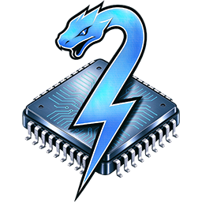

<div align="center">



# PyGPGPU

**English** | [Chinese](README.zh-CN.md)

</div>

Decorate a Python function and it runs on the GPU — one codebase, four backends (**OpenCL / CUDA / HIP / Metal**), plus a serial interpreter backend for the CPU.

```python
import numpy as np
from pygpgpu import kernel

@kernel
def saxpy(x: np.ndarray, y: np.ndarray, alpha: float) -> np.ndarray:
    out = np.zeros_like(x)
    for i in range(out.shape[0]):
        out[i] = x[i] * alpha + y[i]

    return out

x = np.arange(1_000_000, dtype=np.float32)

out = saxpy(x, x, 2.0)              # no backend given: probe cuda -> hip -> metal -> opencl
out = saxpy["cuda:0"](x, x, 2.0)    # the bracket switches backend per call
out = saxpy["hip:0"](x, x, 2.0)     # backend:device
out = saxpy["opencl:0"](x, x, 2.0)
out = saxpy["python"](x, x, 2.0)    # the same function, serially in the interpreter
```

No GPU code to write, no memory copies to manage, no work sizes to compute — call it like an ordinary function and the top-level `for` loop is parallelized on the GPU. The first call translates, compiles and caches; every later call is free.

Already have handwritten kernels? PyGPGPU can also `import` `.cl`/`.cu`/`.hip`/`.metal` files like Python modules, then call the kernels inside them like ordinary Python functions.

## Installation

```bash
pip install pygpgpu
```

Python >= 3.7. Bring your own GPU runtime — any one of them is enough:

| Backend | What you need | Notes |
|---|---|---|
| OpenCL | GPU driver (usually already installed) | Nothing extra; works across NVIDIA/AMD/Intel |
| CUDA | NVIDIA driver (includes NVRTC) | The CUDA Toolkit is not required |
| HIP | AMD HIP SDK | Compiles through the SDK's clang; point `PYGPGPU_HIP_INCLUDES` at extra include dirs if needed |
| Metal | macOS on a real Apple GPU | Compiles through the framework's own runtime; a Mac VM has no Metal device |
| Python | nothing | Selected explicitly with `k["python"]`, never probed |

Without an explicit backend, `@kernel` probes **cuda -> hip -> metal -> opencl** and takes the first that enumerates a device.

## Basic usage

**One decorator for every kind of function.** `@kernel` decorates plain functions, instance methods and static methods; `self.xxx` attributes the body reads become kernel arguments automatically:

```python
class Layer:
    def __init__(self, weights, bias):
        self.weights = weights          # arrays and scalars both work
        self.bias = bias

    @kernel
    def apply(self, x: np.ndarray) -> np.ndarray:
        out = np.zeros_like(x)          # built on the host, above the loop
        for i in range(out.shape[0]):   # the loop bound IS the work size
            out[i] = x[i] * self.weights[i] + self.bias
        return out

    @staticmethod
    @kernel
    def double(x: np.ndarray) -> np.ndarray:
        out = np.zeros_like(x)
        for i in range(out.shape[0]):
            out[i] = x[i] * 2.0
        return out

x = np.ones(4, dtype=np.float32)
layer = Layer(np.arange(4, dtype=np.float32), 0.5)

layer.apply(x)           # -> array([0.5, 1.5, 2.5, 3.5])
layer.apply["cuda"](x)   # brackets work on methods too
Layer.double(x)          # -> array([2., 2., 2., 2.])
```

Type annotations are optional (they serve editors and type checkers, not translation): the device types come from the actual arguments at call time, and the kernel is specialized per type signature.

**Output arrays are return values.** A kernel creates its result with numpy and `return`s it — the shape and dtype come from numpy itself, and the caller receives an ordinary ndarray; there is no `out` parameter to pre-allocate. An object created above the magic loop is built once on the host and shared by every work item; one created inside the loop is device-private per work item. Either can be returned, every `return` statement may have its own shape, and the first work item to return wins.

**Kernel parameters accept plain Python objects.** An object's members become kernel arguments — scalars, arrays, even nested objects (each level is read at call time):

```python
class Params:
    def __init__(self, a, b):
        self.a = a
        self.b = b

@kernel
def scale(p, x: np.ndarray) -> np.ndarray:
    out = np.zeros_like(x)
    for i in range(out.shape[0]):
        out[i] = x[i] * p.a + p.b
    return out

scale(Params(2.0, 10.0), x)      # -> x * 2.0 + 10.0
```

**Kernels can call methods and helpers.** A helper is plain Python — no decorator, no annotations: it is translated into a device function and specialized at the call site, recursively for helpers that call helpers. Besides a module-level function called by its bare name, a kernel can call another method of its own class (`self.other_method`), a static method of any class, a method of an object passed as an argument, and a function reached through a module:

```python
def clamp01(v):                     # module-level helper
    return min(max(v, 0.0), 1.0)

class Scene:
    def hit(self, v):               # a method of an argument object
        return v * v

@kernel
def shade(x: np.ndarray, scene: Scene) -> np.ndarray:
    out = np.zeros_like(x)
    for i in range(out.shape[0]):
        out[i] = clamp01(scene.hit(x[i]))
    return out
```

**A kernel needs an iteration domain** for the work size to be derived from. Either use a magic loop (`for i in range(x.shape[0])`, whose bound is the domain; `np.ndindex`/`np.ndenumerate` for 2-D/3-D) or, when dispatching on `get_global_id`, name the array: `@kernel(domain="x")`. Without either the call raises instead of guessing.

**One bracket syntax** names the backend, the device and the work size — the same on every backend, in any order:

```python
k(args)                          # fully automatic
k["cuda"](args)                  # backend (opencl/cuda/hip/metal/python; aliases ocl/cu/rocm/amd/mtl/py)
k["opencl:gfx1036"](args)        # backend:device
k[(4, 256)](args)                # work size: (blocks per grid, threads per block)
k["cuda"][(4, 256)](args)        # combined; None means automatic
```

The work size is CUDA's `(blocks_per_grid, threads_per_block)` everywhere — OpenCL and Metal included. A block count never has to divide anything: the total is blocks * threads by construction.

**Every backend in one process.** Each backend/device pair is specialized and cached separately, so alternating between them is an extra dictionary lookup, not a recompile — one process can mix vendors, and `k["python"]` is always available as the interpreter fallback.

**Process-wide settings** live on one object, `pygpgpu.config` — there is no `set_...()` to look up:

```python
import pygpgpu

pygpgpu.config.print_info = False                    # progress logging
pygpgpu.config.type_map = {float: np.float64}        # the width a python float travels as
pygpgpu.config.default_device = ["cuda:0", "hip:0"]  # what a plain k(...) tries, in order
```

Every commonly used name is importable from the top level — `kernel`, `funcs`, vector types (`float4`, ...), device builtins (`get_global_id`, `atomic_add`, `barrier`, ...), `list_devices`/`get_device`, `config`, `kernel_import` — so an editor completes `pygpgpu.` and finds them.

## Importing handwritten kernels

`kernel_import` is the import hook that turns existing kernel files into Python modules: kernels and struct types become module attributes, and a `.pyi` stub is generated beside the source so IDE completion works. Write `vecadd.cl`:

```c
__kernel void vecadd(__global const float* a, __global const float* b,
                     __global float* out, const int n)
{
    int i = get_global_id(0);
    if (i >= n) return;         // the launch size may be rounded up, so clamp
    out[i] = a[i] + b[i];
}
```

```python
from pygpgpu import kernel_import

kernel_import.install()
import vecadd                      # one .cl file = one module

out = np.empty_like(a)
vecadd.vecadd(a, a, out, np.int32(len(a)))                    # work size inferred
vecadd.vecadd["opencl"][(3907, 256)](a, a, out, np.int32(len(a)))   # backend + work size
```

A struct `typedef` in the source becomes a ctypes type (a `Pt` above would pass by value, or as an array of structures). Same-named `.cl`/`.cu`/`.hip` files in one package merge into a single module: the same parameter list is one kernel with one implementation per backend (the bracket picks it), different parameter lists become overloads chosen by the argument types, and a bracket naming a backend without an implementation raises `KeyError` at the bracket. ([06](examples/06_handwritten_kernels.py) imports one file; [15](examples/15_kernel_import.py) merges three.)

## Features

- **One decorator for every function** — plain functions, instance methods and static methods all take `@kernel`; the `self.xxx` attributes the body reads become kernel arguments automatically. ([01](examples/01_basic_kernel.py), [03](examples/03_nd_loop_and_class_method.py))
- **Return values** — the result array is created in the body with numpy and `return`ed; the caller receives an ordinary ndarray. Scalars, vectors, structures and arrays all return, every `return` may have its own shape, and the first work item to return wins. ([11_returns_and_scope.py](examples/11_returns_and_scope.py))
- **Python objects as arguments** — pass a plain object and its members (scalars, arrays, nested objects) become kernel arguments, read at call time. ([14](examples/14_heterogeneous_data.py))
- **Python objects inside the kernel** — read nested members and call methods of an argument object (`scene.hit(x)`); together with `self.method(...)`, static methods of any class and module-level functions, the call spellings are exactly ordinary Python's. ([03](examples/03_nd_loop_and_class_method.py), [14](examples/14_heterogeneous_data.py))
- **Objects created inside the kernel** — `np.zeros`/`np.zeros_like` written above the magic loop are built once on the host and shared by every work item; written below the loop they are device-private per work item. Both can be `return`ed. ([14](examples/14_heterogeneous_data.py))
- **Helpers** — a helper called from a kernel needs no decorator and no annotations; it is specialized at the call site, recursively for helpers that call helpers. ([03](examples/03_nd_loop_and_class_method.py))
- **Outer-scope variables** — variables the body reads from outside become kernel parameters, so a changed value is visible on the next call; a scalar declared `nonlocal`/`global` is written back to its scope after the call. ([11_returns_and_scope.py](examples/11_returns_and_scope.py))
- **Non-blocking launches** — `submit()` (a `concurrent.futures.Future`) and `await k.async_call(...)` (an `asyncio.Future`) on the same decorated function; the brackets apply here too. ([10](examples/10_async_launch.py))

## How it compares

The same computation in this library and three other GPU-from-Python projects ([Taichi](https://www.taichi-lang.org/), [Numba](https://numba.pydata.org/), [NVIDIA Warp](https://github.com/NVIDIA/warp)). The API gap is widest around the ways you write things: helpers stay ordinary Python, arguments can be plain Python objects, instance/static methods decorate directly, and output arrays are return values.

**PyGPGPU** — arrays in, an array returned; no launch geometry, no buffer management, and helpers need no decorator at all:

```python
from pygpgpu import kernel

def clamp01(v):                         # plain Python: no decorator, no annotations
    return min(max(v, 0.0), 1.0)

def weight(v):                          # helpers may call other helpers
    return clamp01(v * v) * 0.5 + 0.25

@kernel
def apply_all(x: np.ndarray) -> np.ndarray:
    out = np.zeros_like(x)              # output arrays are return values
    for i in range(out.shape[0]):       # loop bound = work size
        out[i] = weight(x[i])
    return out

out = apply_all(x)                      # numpy arrays as-is
out = apply_all["hip"](x)               # the same function, another backend
```

**Taichi** — declare fields first, then copy data in and out by hand; a helper needs `@ti.func` and every argument must be annotated:

```python
import taichi as ti
ti.init(arch=ti.gpu)

x = ti.field(ti.f32, n)
y = ti.field(ti.f32, n)
out = ti.field(ti.f32, n)
x.from_numpy(nx)
y.from_numpy(ny)

@ti.func                                  # helpers need their own decorator
def weight(v: ti.f32) -> ti.f32:
    return ti.max(0.0, ti.min(1.0, v * v)) * 0.5 + 0.25

@ti.kernel
def saxpy(a: ti.f32):
    for i in range(n):
        out[i] = x[i] * a + y[i] + weight(x[i])

saxpy(2.0)
res = out.to_numpy()
```

**Numba** — compute blocks/threads yourself, guard inside, manage device memory; callable helpers are compiled separately with `@cuda.jit(device=True)`:

```python
from numba import cuda

@cuda.jit(device=True)                    # helpers need device=True
def weight(v):
    return min(1.0, max(0.0, v * v)) * 0.5 + 0.25

@cuda.jit
def saxpy(x, y, out, a):
    i = cuda.grid(1)
    if i < out.size:                      # bounds guard is your job
        out[i] = x[i] * a + y[i] + weight(x[i])

d_x = cuda.to_device(nx)
d_y = cuda.to_device(ny)
d_out = cuda.device_array_like(nx)
threads = 256
saxpy[(n + threads - 1) // threads, threads](d_x, d_y, d_out, 2.0)
res = d_out.copy_to_host()
```

**Warp** — typed array parameters, the launch size is passed explicitly, and helpers need `@wp.func`:

```python
import warp as wp
wp.init()

@wp.func                                  # helpers need their own decorator
def weight(v: float) -> float:
    return wp.min(1.0, wp.max(0.0, v * v)) * 0.5 + 0.25

@wp.kernel
def saxpy(x: wp.array(dtype=float), y: wp.array(dtype=float),
          out: wp.array(dtype=float), a: float):
    i = wp.tid()
    out[i] = x[i] * a + y[i] + weight(x[i])

wp.launch(saxpy, dim=n, inputs=[x, y, out, 2.0])
```

| | PyGPGPU | Taichi | Numba | Warp |
|---|---|---|---|---|
| Input data | numpy arrays directly | wrap in `ti.field`, explicit copies | `cuda.to_device` + `copy_to_host` | wrap in `wp.array` |
| Result | **the kernel returns an ndarray** | `out.to_numpy()` by hand | `copy_to_host()` by hand | written into a `wp.array` you manage |
| Helper functions | **plain Python — no decorator, annotations optional** | `@ti.func` + annotated args | `@cuda.jit(device=True)` | `@wp.func` + annotated args |
| Python objects as arguments | **yes — members become kernel arguments** | no (arrays must be wrapped in `ti.field`) | no (scalars and device arrays only) | no (needs `wp.array`) |
| Accessing Python objects in a kernel | **yes — read nested members, call their methods** | no | no | no |
| Instance methods | **yes — `self.xxx` becomes arguments automatically** | instance methods in a `@ti.data_oriented` class | no | no |
| Static methods | **yes** | no (only those instance methods) | no | no |
| Backends in one process | **all, mixed freely via brackets** | one, fixed by `ti.init` | CUDA only | CUDA only |
| Backends | OpenCL, CUDA, HIP, Metal | CPU, CUDA, Vulkan, ... | CPU, CUDA | CPU, CUDA |
| Copy optimization | **uploads/read-backs skipped per argument** | no | no | no |

Where the others are ahead, worth knowing before you pick: automatic differentiation (Taichi, Warp), sparse data structures (Taichi), and throughput-oriented CPU execution — the `python` backend here is serial and meant for testing. This table was written from each project's documentation; their APIs move fast, so confirm against current docs before relying on a cell.

## More documentation

The numbered scripts in [examples/](examples/) are standalone end-to-end tours; [examples/README.md](examples/README.md) lists them all with each one's dependencies:

| Topic | Examples |
|---|---|
| `@kernel` basics, brackets, device selection | [01](examples/01_basic_kernel.py), [02](examples/02_backend_device_selection.py) |
| 2-D/3-D magic loops, class methods, helpers by name | [03](examples/03_nd_loop_and_class_method.py) |
| Every kind of kernel value: arguments, built objects, returns | [14](examples/14_heterogeneous_data.py) |
| Vector types and the dual-sided `funcs` | [04](examples/04_vector_types.py) |
| Device-resident `gnp` arrays, zero copy, atomics | [05](examples/05_gnp_zero_copy_and_atomics.py), [19](examples/19_device_resident_arrays.py) |
| Handwritten kernels: one file; a multi-backend module | [06](examples/06_handwritten_kernels.py), [15](examples/15_kernel_import.py) |
| Low-level OOP API | [07](examples/07_low_level_oop.py) |
| Comparing backends on one machine | [08](examples/08_compare_backends.py) |
| Atomics and shared-memory reduction | [09](examples/09_reduction.py) |
| Async launches; the pure-Python backend; returns and scope | [10](examples/10_async_launch.py), [11](examples/11_python_backend.py), [11_returns_and_scope.py](examples/11_returns_and_scope.py) |
| `print()` in a kernel; images | [12](examples/12_print_in_kernel.py), [13](examples/13_image.py) |
| Scientific math and `device_function` | [16](examples/16_scientific_math.py) |
| The Metal backend | [17](examples/17_metal_backend.py), [18](examples/18_metal_device_check.py) |

## License

MIT
