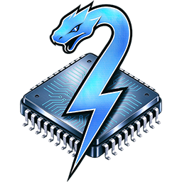

<div align="center">



# PyGPGPU

[English](README.md) | **中文**

</div>

装饰一个 Python 函数, 它就运行在 GPU 上——同一份代码, 四个后端 (**OpenCL / CUDA / HIP / Metal**), 外加一个在 CPU 上串行执行的解释器后端。

```python
import numpy as np
from pygpgpu import kernel

@kernel
def saxpy(x: np.ndarray, y: np.ndarray, alpha: float) -> np.ndarray:
    out = np.zeros_like(x)
    for i in range(out.shape[0]):
        out[i] = x[i] * alpha + y[i]

    return out

x = np.arange(1_000_000, dtype=np.float32)

out = saxpy(x, x, 2.0)              # 未指定后端: 按 cuda -> hip -> metal -> opencl 探测
out = saxpy["cuda:0"](x, x, 2.0)    # 中括号在每次调用时切换后端
out = saxpy["hip:0"](x, x, 2.0)     # 后端:设备
out = saxpy["opencl:0"](x, x, 2.0)
out = saxpy["python"](x, x, 2.0)    # 同一个函数, 在解释器里串行运行
```

不需要写任何 GPU 代码、不需要拷贝内存、不需要关心工作区尺寸，像普通函数一样使用，顶层 for 循环自动并行化在 GPU 上运行。首次调用时自动翻译/编译并缓存, 之后零开销调用。

另外，已有手写 kernel 也没关系——PyGPGPU 还支持将 `.cl`/`.cu`/`.hip`/`.metal` 文件像 Python 模块一样直接 `import`，然后像使用普通 Python 函数一样调用其中的内核函数。

## 安装

```bash
pip install pygpgpu
```

Python >= 3.7。GPU 运行时按需自备——任一即可:

| 后端 | 需要安装 | 说明 |
|---|---|---|
| OpenCL | GPU 驱动(通常已带) | 零额外安装, 支持 NVIDIA/AMD/Intel |
| CUDA | NVIDIA 驱动(含 NVRTC) | 不需要 CUDA Toolkit |
| HIP | AMD HIP SDK | 编译走 SDK 自带的 clang; 头文件不在默认路径时用 `PYGPGPU_HIP_INCLUDES` 指定 |
| Metal | 真实 Apple GPU 上的 macOS | 走框架自带的运行期编译器; Mac 虚拟机没有 Metal 设备 |
| Python | 无 | 用 `k["python"]` 显式选择, 不参与自动探测 |

`@kernel` 未指定后端时, 按 **cuda -> hip -> metal -> opencl** 顺序探测, 取第一个枚举到设备的后端。

## 基本用法

**一种装饰器, 装饰所有函数。** `@kernel` 可以装饰普通函数、实例方法和静态方法; 函数体读取的 `self.xxx` 属性会自动成为 kernel 参数:

```python
class Layer:
    def __init__(self, weights, bias):
        self.weights = weights          # 数组与标量都可以
        self.bias = bias

    @kernel
    def apply(self, x: np.ndarray) -> np.ndarray:
        out = np.zeros_like(x)          # 在宿主侧创建, 位于循环之外
        for i in range(out.shape[0]):   # 循环上界就是 work size
            out[i] = x[i] * self.weights[i] + self.bias
        return out

    @staticmethod
    @kernel
    def double(x: np.ndarray) -> np.ndarray:
        out = np.zeros_like(x)
        for i in range(out.shape[0]):
            out[i] = x[i] * 2.0
        return out

x = np.ones(4, dtype=np.float32)
layer = Layer(np.arange(4, dtype=np.float32), 0.5)

layer.apply(x)           # -> array([0.5, 1.5, 2.5, 3.5])
layer.apply["cuda"](x)   # 方法上同样可以用中括号
Layer.double(x)          # -> array([2., 2., 2., 2.])
```

类型注解是可选的(它们服务于编辑器与类型检查器, 不参与翻译): 设备类型来自调用时的实参, kernel 按类型签名分别特化。

**输出数组用返回值表示。** kernel 用 numpy 创建结果并 `return` 它——形状与 dtype 由 numpy 自己决定, 调用方拿到的是普通 ndarray; 不需要预先分配 `out` 参数。魔法循环之外创建的对象在宿主上创建一次、由所有工作项共享; 循环之内创建的是每个工作项私有的设备端对象。两者都可以返回, 每条 `return` 语句可以有各自的形状, 第一个 return 的工作项获胜。

**kernel 参数接受普通 Python 对象。** 对象的成员会成为 kernel 参数——标量、数组、甚至嵌套对象(每一层都在调用时读取):

```python
class Params:
    def __init__(self, a, b):
        self.a = a
        self.b = b

@kernel
def scale(p, x: np.ndarray) -> np.ndarray:
    out = np.zeros_like(x)
    for i in range(out.shape[0]):
        out[i] = x[i] * p.a + p.b
    return out

scale(Params(2.0, 10.0), x)      # -> x * 2.0 + 10.0
```

**kernel 可以调用方法与辅助函数。** 辅助函数就是普通 Python——不需要装饰器、不需要注解: 它被翻译成设备函数, 并在调用点按实参类型单态化, 子函数再调子函数也递归支持。除了用裸名字调用的模块级函数, kernel 还可以调用同一个类的另一个方法(`self.other_method`)、任意类的静态方法、参数对象的方法, 以及经由模块取到的函数:

```python
def clamp01(v):                     # 模块级辅助函数
    return min(max(v, 0.0), 1.0)

class Scene:
    def hit(self, v):               # 参数对象的方法
        return v * v

@kernel
def shade(x: np.ndarray, scene: Scene) -> np.ndarray:
    out = np.zeros_like(x)
    for i in range(out.shape[0]):
        out[i] = clamp01(scene.hit(x[i]))
    return out
```

**kernel 需要一个迭代域**来推导 work size。要么用魔法循环(`for i in range(x.shape[0])`, 循环上界就是迭代域; 二维/三维用 `np.ndindex`/`np.ndenumerate`); 要么在基于 `get_global_id` 的写法里用装饰器指明数组: `@kernel(domain="x")`。三者都没有时调用会直接报错, 而不是猜测。

**统一的中括号语法**指定后端、设备与 work size——所有后端一致, 顺序不限:

```python
k(args)                          # 全自动
k["cuda"](args)                  # 后端 (opencl/cuda/hip/metal/python; 别名 ocl/cu/rocm/amd/mtl/py)
k["opencl:gfx1036"](args)        # 后端:设备
k[(4, 256)](args)                # work size: (blocks per grid, threads per block)
k["cuda"][(4, 256)](args)        # 组合; None 为自动
```

work size 在所有后端上都是 CUDA 的 `(blocks_per_grid, threads_per_block)`——OpenCL 和 Metal 也一样。block 数不需要能被什么整除: 总量本就是 blocks * threads。

**同一进程内各后端并存。** 每个 "后端 + 设备" 组合单独特化并缓存, 所以在它们之间切换只是一次字典查找, 而不是重新编译——一个进程可以混用各厂商的设备, 且 `k["python"]` 永远可用作解释器回退。

**进程级设置**都在同一个对象 `pygpgpu.config` 上——没有需要另查的 `set_...()`:

```python
import pygpgpu

pygpgpu.config.print_info = False                    # 进度日志
pygpgpu.config.type_map = {float: np.float64}        # python float 使用的宽度
pygpgpu.config.default_device = ["cuda:0", "hip:0"]  # 不带中括号的 k(...) 依次尝试
```

常用名字都能从顶层直接导入——`kernel`、`funcs`、向量类型(`float4` 等)、设备内建(`get_global_id`、`atomic_add`、`barrier` 等)、`list_devices`/`get_device`、`config`、`kernel_import`——编辑器补全 `pygpgpu.` 就能看到。

## 导入手写 kernel

`kernel_import` 是把已有 kernel 文件变成 Python 模块的导入钩子: kernel 与 struct 类型成为模块属性, 源码旁自动生成 `.pyi` 供 IDE 补全。写一个 `vecadd.cl`:

```c
__kernel void vecadd(__global const float* a, __global const float* b,
                     __global float* out, const int n)
{
    int i = get_global_id(0);
    if (i >= n) return;         // 启动规模可能被向上取整, 所以要自己守卫
    out[i] = a[i] + b[i];
}
```

```python
from pygpgpu import kernel_import

kernel_import.install()
import vecadd                      # 一个 .cl 文件 = 一个模块

out = np.empty_like(a)
vecadd.vecadd(a, a, out, np.int32(len(a)))                    # 自动推断 work size
vecadd.vecadd["opencl"][(3907, 256)](a, a, out, np.int32(len(a)))   # 后端 + work size
```

源码里的 struct `typedef` 会变成 ctypes 类型(上面的 `Pt` 既可以按值传递, 也可以作为结构体数组)。同一个包里同名的 `.cl`/`.cu`/`.hip` 文件合并为一个模块: 参数表相同的是同一个 kernel 的多个后端实现(中括号选择), 参数表不同则成为按实参类型选择的重载, 中括号指到没有实现的后端时在括号处抛 `KeyError`。([06](examples/06_handwritten_kernels.py) 导入单个文件; [15](examples/15_kernel_import.py) 合并三个。)

## 特性

- **`@kernel` 装饰一切** —— 普通函数、实例方法、静态方法都能直接装饰; 函数体读取的 `self.xxx` 属性自动成为 kernel 参数。([01](examples/01_basic_kernel.py)、[03](examples/03_nd_loop_and_class_method.py))
- **返回值** —— 结果数组在函数体内用 numpy 创建并 `return`, 调用方直接拿到 ndarray; 标量、向量、结构体、数组都可返回, 每条 `return` 可以有不同形状, 第一个 return 的工作项获胜。([11_returns_and_scope.py](examples/11_returns_and_scope.py))
- **Python 对象作为参数** —— 普通对象直接传入, 其成员(标量、数组、嵌套对象)自动成为 kernel 参数, 全部在调用时读取。([14](examples/14_heterogeneous_data.py))
- **内核内部访问 Python 对象** —— 嵌套成员照常读, 参数对象的方法照常调(`scene.hit(x)`); 加上 `self.method(...)`、任意类的静态方法、模块级函数, 调用写法与普通 Python 完全一致。([03](examples/03_nd_loop_and_class_method.py)、[14](examples/14_heterogeneous_data.py))
- **内核内部创建对象** —— `np.zeros`/`np.zeros_like` 等写在魔法循环之外, 宿主上创建一次、由所有工作项共享; 写在循环之内, 则是每个工作项私有的设备端对象; 两者都可以 `return`。([14](examples/14_heterogeneous_data.py))
- **子函数** —— kernel 里调用的子函数不需要装饰器、不需要注解, 在调用点按实参类型单态化, 子函数再调子函数递归支持。([03](examples/03_nd_loop_and_class_method.py))
- **访问外层作用域变量** —— 函数体读取的外层变量成为 kernel 参数, 改变后下一次调用立即生效; 用 `nonlocal`/`global` 声明的标量在调用后写回原作用域。([11_returns_and_scope.py](examples/11_returns_and_scope.py))
- **异步启动** —— 同一个装饰函数上有 `submit()`(`concurrent.futures.Future`)与 `await k.async_call(...)`(`asyncio.Future`), 中括号同样适用。([10](examples/10_async_launch.py))

## 与其他库的用法对比

同一段计算, 用本库和另外三个 "从 Python 调用 GPU" 的项目([Taichi](https://www.taichi-lang.org/)、[Numba](https://numba.pydata.org/)、[NVIDIA Warp](https://github.com/NVIDIA/warp))分别怎么写。API 差距最明显的地方在各种写法上: 子函数就是普通 Python, 参数可以直接是 Python 对象, 实例/静态方法可直接装饰, 输出数组用返回值表示。

**PyGPGPU** —— 数组直接进、数组返回; 不用管启动规模, 不用管缓冲, 子函数也不需要任何装饰器:

```python
from pygpgpu import kernel

def clamp01(v):                         # 普通 Python: 不需要装饰器、不需要注解
    return min(max(v, 0.0), 1.0)

def weight(v):                          # 子函数里还能继续调子函数
    return clamp01(v * v) * 0.5 + 0.25

@kernel
def apply_all(x: np.ndarray) -> np.ndarray:
    out = np.zeros_like(x)              # 输出数组用返回值表示
    for i in range(out.shape[0]):       # 循环上界 = work size
        out[i] = weight(x[i])
    return out

out = apply_all(x)                      # numpy 数组直接传
out = apply_all["hip"](x)               # 同一个函数, 换个后端
```

**Taichi** —— 先声明 field, 再手动把数据拷进拷出; 子函数要 `@ti.func`, 且参数必须标注类型:

```python
import taichi as ti
ti.init(arch=ti.gpu)

x = ti.field(ti.f32, n)
y = ti.field(ti.f32, n)
out = ti.field(ti.f32, n)
x.from_numpy(nx)
y.from_numpy(ny)

@ti.func                                  # 子函数要自己的装饰器
def weight(v: ti.f32) -> ti.f32:
    return ti.max(0.0, ti.min(1.0, v * v)) * 0.5 + 0.25

@ti.kernel
def saxpy(a: ti.f32):
    for i in range(n):
        out[i] = x[i] * a + y[i] + weight(x[i])

saxpy(2.0)
res = out.to_numpy()
```

**Numba** —— block/thread 数自己算, 边界守卫自己写, 设备内存自己管; 子函数要 `@cuda.jit(device=True)`:

```python
from numba import cuda

@cuda.jit(device=True)                    # 子函数要 device=True
def weight(v):
    return min(1.0, max(0.0, v * v)) * 0.5 + 0.25

@cuda.jit
def saxpy(x, y, out, a):
    i = cuda.grid(1)
    if i < out.size:                      # 边界守卫要自己写
        out[i] = x[i] * a + y[i] + weight(x[i])

d_x = cuda.to_device(nx)
d_y = cuda.to_device(ny)
d_out = cuda.device_array_like(nx)
threads = 256
saxpy[(n + threads - 1) // threads, threads](d_x, d_y, d_out, 2.0)
res = d_out.copy_to_host()
```

**Warp** —— 参数要标类型, 启动规模显式传, 子函数要 `@wp.func`:

```python
import warp as wp
wp.init()

@wp.func                                  # 子函数要自己的装饰器
def weight(v: float) -> float:
    return wp.min(1.0, wp.max(0.0, v * v)) * 0.5 + 0.25

@wp.kernel
def saxpy(x: wp.array(dtype=float), y: wp.array(dtype=float),
          out: wp.array(dtype=float), a: float):
    i = wp.tid()
    out[i] = x[i] * a + y[i] + weight(x[i])

wp.launch(saxpy, dim=n, inputs=[x, y, out, 2.0])
```

| | PyGPGPU | Taichi | Numba | Warp |
|---|---|---|---|---|
| 输入数据 | numpy 数组直接用 | 包进 `ti.field`, 手动拷贝 | 手动 `cuda.to_device` + `copy_to_host` | 包进 `wp.array` |
| 结果 | **kernel 直接返回 ndarray** | 手动 `out.to_numpy()` | 手动 `copy_to_host()` | 写进自己管理的 `wp.array` |
| 子函数 | **普通 Python——不需要装饰器, 注解可选** | `@ti.func` + 标注参数 | `@cuda.jit(device=True)` | `@wp.func` + 标注参数 |
| Python 对象作为参数 | **支持——成员自动成为 kernel 参数** | 不支持(数组需包成 `ti.field`) | 不支持(仅标量与设备数组) | 不支持(需 `wp.array`) |
| 内核内部访问 Python 对象 | **支持——读嵌套成员、调用其方法** | 不支持 | 不支持 | 不支持 |
| 装饰实例方法 | **支持——`self.xxx` 自动成为参数** | `@ti.data_oriented` 类内的实例方法 | 不支持 | 不支持 |
| 装饰静态方法 | **支持** | 不支持(仅上述实例方法) | 不支持 | 不支持 |
| 同进程多后端 | **全部, 中括号自由混用** | 只有一个, 由 `ti.init` 固定 | 仅 CUDA | 仅 CUDA |
| 后端 | OpenCL, CUDA, HIP, Metal | CPU, CUDA, Vulkan 等 | CPU, CUDA | CPU, CUDA |
| 拷贝优化 | **按参数跳过上传/回读** | 不支持 | 不支持 | 不支持 |

这几个项目更强的地方, 选型前值得了解: 自动微分(Taichi、Warp)、稀疏数据结构(Taichi)、面向吞吐的 CPU 执行——本库的 `python` 后端是串行的, 定位是测试。此表依据各项目文档整理, 它们的 API 迭代很快, 依赖某一格之前请核对当前文档。

## 更多文档

[examples/](examples/) 里的编号脚本是各自独立、端到端的演示; [examples/README.md](examples/README.md) 列出全部示例及其依赖:

| 主题 | 示例 |
|---|---|
| `@kernel` 基础、中括号、设备选择 | [01](examples/01_basic_kernel.py)、[02](examples/02_backend_device_selection.py) |
| 二维/三维魔法循环、类方法、按名字调用的子函数 | [03](examples/03_nd_loop_and_class_method.py) |
| kernel 携带的每一种值: 参数、函数体内创建的对象、返回值 | [14](examples/14_heterogeneous_data.py) |
| 向量类型与双面 `funcs` | [04](examples/04_vector_types.py) |
| 常驻设备的 `gnp` 数组、零拷贝、原子操作 | [05](examples/05_gnp_zero_copy_and_atomics.py)、[19](examples/19_device_resident_arrays.py) |
| 手写 kernel: 单文件; 多后端模块 | [06](examples/06_handwritten_kernels.py)、[15](examples/15_kernel_import.py) |
| 底层 OOP API | [07](examples/07_low_level_oop.py) |
| 同一台机器上对比后端 | [08](examples/08_compare_backends.py) |
| 原子操作与共享内存归约 | [09](examples/09_reduction.py) |
| 异步启动; 纯 Python 后端; 返回值与作用域 | [10](examples/10_async_launch.py)、[11](examples/11_python_backend.py)、[11_returns_and_scope.py](examples/11_returns_and_scope.py) |
| kernel 里 `print()`; 图像 | [12](examples/12_print_in_kernel.py)、[13](examples/13_image.py) |
| 科学计算函数与 `device_function` | [16](examples/16_scientific_math.py) |
| Metal 后端 | [17](examples/17_metal_backend.py)、[18](examples/18_metal_device_check.py) |

## 许可证

MIT
